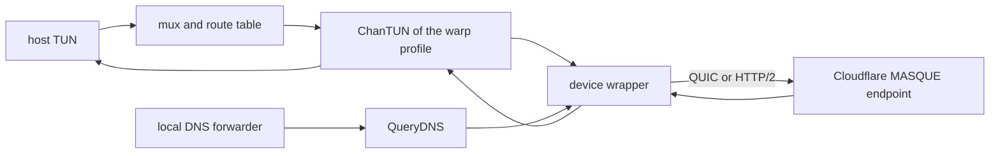

# Cloudflare WARP Route Profile - Plan

## Goal Capsule

**Objective.** One host carries traffic to its tailnets and to the internet through Cloudflare WARP at the same time, with one command deciding which path a packet takes and one view reporting whether each path is up.

**Means.** A third profile kind built on a forked usque.

**Product authority.** `docs/architecture.md` keeps the existing rules: one engine per profile, one shared host TUN, and no active-tailnet switch. This work adds a kind and adds no routing concept.

**Open blockers.** None.

**Execution profile.** Code execution in this repository, `make check` as the gate, and one commit per implementation unit following `docs/commit-messages.md`.

**Delivery.** The agent implements the units in order, runs the checks, and commits each one. No step depends on an external service at build time.

---

## Product Contract

### Summary

A WARP profile runs a MASQUE tunnel through Cloudflare, advertises a full-tunnel default, and takes part in exit-node selection, longest-prefix routing, and DNS exactly as a tailnet exit node does. It needs no peers, no Tailscale identity, and no separate client process.

### Problem Frame

A tailnet exit node sends everything to a network you own. Cloudflare WARP sends everything somewhere else. A host that needs both today runs the usque CLI beside tailmix, and nothing coordinates the two: both claim a default route, two programs write the resolver set, and the operator arranges policy routing by hand. When a lookup or a connection leaves the wrong way, no single place explains which path it took or why.

### Requirements

**Profile kind**

- R1. WARP is a profile kind named `warp`, stored in `state.json` beside tailscale and wireguard profiles and listed by every command that lists profiles.
- R2. `tailmix warp register <name>` creates a WARP profile, registers it with Cloudflare, and starts it in one command. The command takes Terms of Service consent on the terminal before the daemon performs the enrollment call, which needs no prompt.
- R3. `tailmix warp register <name> --jwt-file <path>` enrolls through ZeroTrust instead of a consumer registration, reading the team token from the file so it never appears in the argument list.
- R4. `tailmix warp register <name> --config <path>` creates the profile from a `config.json` written by the usque CLI, without contacting Cloudflare. The file must carry the MASQUE fields and both tunnel addresses, and the operator stops any other WARP client before the profile starts.
- R5. A WARP profile is enabled, disabled, renamed, aliased and removed through the existing profile commands, with no WARP-specific variant.
- R6. Removing a WARP profile follows the existing removal semantics: a plain removal keeps its credentials and state directory, and a purge deletes them. Deleting them does not revoke the Cloudflare registration.

**Credentials**

- R7. A WARP profile stores its private key, registration ID, access token, license, the endpoint public key that pins the tunnel handshake, the QUIC and HTTP/2 endpoint addresses for both families, and the tunnel addresses Cloudflare assigned, inside the profile's own state directory.
- R8. The private key and access token files are readable only by their owner.
- R9. No command prints a private key, an access token, or a license; profile output reports only whether usable credentials exist.
- R10. A WARP profile without usable credentials reports a distinct backend state that names re-registration as the fix, and opens no tunnel.
- R11. Re-registration replaces stored credentials atomically, so an interrupted re-key leaves the previous credentials in place.

**Tunnel engine**

- R12. The engine opens a MASQUE Connect-IP tunnel to the registered endpoint, over QUIC by default, with a per-profile option to use the HTTP/2 path, and the tunnel's own transport leaves through the host's physical link rather than the default route the tunnel installs.
- R13. The engine reports the tunnel addresses assigned at registration as its self addresses, so route policy can compute its host sources.
- R14. The engine reports connection-state changes through the update channel the existing engines use, so the supervisor reconciles without polling.
- R15. The engine reconnects after a dropped tunnel with backoff and reports each transition, rather than exiting or blocking.
- R16. `Close` stops the tunnel and releases the device, and no goroutine survives it.
- R17. The engine exposes no exit-node preference control, no route-acceptance control, and no local Tailscale backend, and the supervisor treats each absence as normal for this kind.
- R18. Packets the engine reads from its device leave through the tunnel, and packets the tunnel delivers are written back to the device, with no address translation inside the engine.
- R19. A stalled handshake surfaces as an unavailable backend state and never blocks the reconcile loop.

**Routing**

- R20. A WARP profile advertises `0.0.0.0/0` and `::/0` as its available routes.
- R21. Selecting a WARP profile as exit node gives it the default route for both address families, and a selected WARP profile that is not connected keeps that default in place as a drop rather than letting the host's physical default take over.
- R22. An explicit `routes bind` for a more specific prefix still wins over the WARP default.
- R23. A WARP exit-node selection survives a restart, and validation of the stored selection is kind-aware.
- R24. Only one profile holds the default route: selecting a WARP exit node clears a tailnet exit-node selection, and the reverse.
- R25. A WARP profile that is not the selected exit node carries only the traffic an explicit binding sends to it, and a binding to a zero-length prefix counts as covered by the advertised default.

**DNS**

- R26. While a WARP profile is the selected exit node, it contributes one resolver address as the root `.` DNS route, and lookups on that route dial through the same profile. The address defaults to `1.1.1.1`, `tailmix warp register --dns <address>` overrides it, and it is stored with the profile.
- R27. A MagicDNS suffix from any tailnet still wins over the WARP root route by longest suffix.
- R28. Unselecting WARP removes its DNS route, a WARP profile that is not the exit node contributes no DNS route, and a selected WARP profile that is not connected contributes none either.

**CLI and status**

- R29. `tailmix profiles list` and `tailmix status` show a WARP profile with its kind, backend state, and whether it holds the default route.
- R30. `tailmix status` for a WARP profile shows its tunnel address, the time since its last successful connection, and an empty peer list.
- R31. `tailmix exit-node` accepts a WARP profile name with no peer argument and lists the WARP profile among the available exit nodes.
- R32. WARP errors use the existing error codes, plus one code that separates a credential or registration problem from an unavailable tunnel.
- R33. `tailmix warp register` writes no profile when Cloudflare rejects the request, the network is unreachable, or Terms of Service consent is refused.
- R34. Completion for the new subcommand and its flags comes from the existing completion path.

**Platform and safety**

- R35. Creating a WARP profile on a platform other than Linux fails with a clear error that names the platform limit.
- R36. A state file that names a WARP profile still loads on macOS, that profile reports the platform error, and the other profiles keep working.
- R37. The forked source lands as one unmodified snapshot commit of the pinned upstream revision, with upstream copyright headers, its license, a README that links the upstream repository and commit, and an `UPSTREAM` record.
- R38. tailmix adaptations to the fork land in commits after that snapshot.
- R39. The fork removes fatal exits and endpoint logging from the tunnel path.
- R40. No new log line names an IP address, a DNS name, a node name, a peer identity, or a packet endpoint; registration and connection logs name the profile only.
- R41. The generated license report is regenerated in the same change, and the license check passes.

### Key Decisions

- **WARP behaves as a peerless exit node.** It advertises a full-tunnel default and reuses the existing default-route, longest-prefix, and exit-node-selection rules, so route policy gains no new class. Governs R20, R21, R22, R23, R24, R31. (session-settled: user-directed — chosen over a new route class: no new policy surface to learn or fail closed on)
- **Support both registration and config import.** The Cloudflare registration API is called directly, and a usque `config.json` can be imported when one already exists. Governs R2, R3, R4, R7. (session-settled: user-directed — chosen over registration only: nobody must keep usque installed to migrate)
- **WARP DNS behaves as an exit profile's DNS.** The root `.` route appears only while WARP is the selected exit node, its resolver is a stored address dialed through the tunnel, and tailnet suffixes keep priority by longest match. Governs R26, R27, R28. (session-settled: user-directed)
- **Linux only for this change.** The engine, the state-file tolerance, and the error path are scoped to Linux and to failing loudly elsewhere. Governs R35, R36. (session-settled: user-directed — chosen over macOS parity now: it splits the test surface)
- **Fork usque rather than consume its `api` package.** Upstream `MaintainTunnel` returns nothing and reports connect state only through executable-path hooks, so a status channel and Go callbacks are unavoidable. Governs R12, R14, R15, R37, R38, R39. (session-settled: user-directed — chosen over shelling out to the usque binary: status, reconnect, and privacy control stay inside the daemon)

### Actors

- A1. Operator. Runs `tailmix warp register`, selects an exit node, binds prefixes, and reads status.
- A2. Daemon. Owns desired state, constructs one engine per profile, and reconciles the route table, host routes, and DNS.
- A3. WARP engine. Holds the tunnel, reports state, and moves packets between its device and Cloudflare.
- A4. Cloudflare registration API. Issues credentials and tunnel addresses for a device registration.

### Key Flows

- F1. First registration.
  - **Trigger:** The operator runs `tailmix warp register <name>`.
  - **Actors:** A1, A2, A4.
  - **Steps:** The command takes Terms of Service consent, the daemon enrolls the device, receives credentials and tunnel addresses, writes the profile, and starts the engine.
  - **Outcome:** The tunnel is up and `tailmix status` reports the profile connected.
  - **Covered by:** R2, R7, R13.
- F2. Unattended start.
  - **Trigger:** The daemon starts with stored WARP credentials.
  - **Actors:** A2, A3.
  - **Steps:** The engine dials, reports state transitions, and settles in the running state.
  - **Outcome:** The profile is connected with no user action.
  - **Covered by:** R14, R15, R19.
- F3. Default switch to WARP.
  - **Trigger:** The operator runs `tailmix exit-node` with the WARP profile and no peer.
  - **Actors:** A1, A2, A3.
  - **Steps:** A tailnet exit-node selection is cleared, WARP gains the default for both families, and the root DNS route points at the WARP resolver.
  - **Outcome:** Unbound traffic leaves through WARP.
  - **Covered by:** R21, R24, R26, R31.
- F4. Default switch back.
  - **Trigger:** The operator selects a tailnet peer as exit node.
  - **Actors:** A1, A2.
  - **Steps:** WARP loses the default and its DNS route, and the tailnet exit node takes both.
  - **Outcome:** Unbound traffic returns to the tailnet and the resolver set returns to its previous state.
  - **Covered by:** R24, R28.
- F5. Prefix override while WARP is default.
  - **Trigger:** The operator binds `10.0.0.0/8` to a tailnet while WARP holds the default.
  - **Actors:** A1, A2.
  - **Steps:** The longer prefix wins for that range and every other destination keeps the WARP default.
  - **Outcome:** Both paths carry traffic at once.
  - **Covered by:** R22, R25.
- F6. WARP alongside a tailnet default.
  - **Trigger:** A tailnet exit node holds the default while the WARP profile is enabled but unselected.
  - **Actors:** A2, A3.
  - **Steps:** WARP keeps its tunnel up and receives only bound prefixes.
  - **Outcome:** The tailnet default is unchanged.
  - **Covered by:** R25.
- F7. Import.
  - **Trigger:** The operator runs `tailmix warp register --config <path>`.
  - **Actors:** A1, A2.
  - **Steps:** The operator stops any other WARP client, the profile is written from the file without a Cloudflare call, and the engine starts.
  - **Outcome:** An existing usque registration works without re-registering.
  - **Covered by:** R4.
- F8. Restart.
  - **Trigger:** The daemon restarts while WARP is the selected exit node.
  - **Actors:** A2, A3.
  - **Steps:** The selection loads intact, the engine reconnects, and the default is rebuilt.
  - **Outcome:** The host returns to its previous routing state.
  - **Covered by:** R15, R23.
- F9. Unsupported host.
  - **Trigger:** The operator runs `tailmix warp register` on macOS.
  - **Actors:** A1, A2.
  - **Steps:** The command fails with the platform error and writes no profile.
  - **Outcome:** The state file is unchanged.
  - **Covered by:** R35.

### Acceptance Examples

- AE1.
  - **Covers R23.**
  - **Given:** A state file holds an exit-node selection with an empty node ID and an invalid peer IP against a `warp` profile.
  - **When:** The daemon loads the file.
  - **Then:** The selection is still present.
- AE2.
  - **Covers R24.**
  - **Given:** A tailnet exit node is selected.
  - **When:** The operator selects WARP, then later selects the tailnet peer again.
  - **Then:** Each selection clears the other, and both the default route and the root DNS route move with it.
- AE3.
  - **Covers R27.**
  - **Given:** A tailnet advertises `corp.example` and WARP is the exit node.
  - **When:** The host resolves `host.corp.example` and then `example.com`.
  - **Then:** The first lookup reaches the tailnet resolver and the second reaches the WARP resolver.
- AE4.
  - **Covers R21.**
  - **Given:** WARP is the exit node and the profile has a tunnel address for both families.
  - **When:** The host sends to a public IPv4 address and to a public IPv6 address.
  - **Then:** Both leave through the WARP tunnel.
- AE5.
  - **Covers R22.**
  - **Given:** WARP holds the default and `10.0.0.0/8` is bound to a tailnet.
  - **When:** The host sends to `10.1.2.3` and then to a public address.
  - **Then:** The first reaches the tailnet and the second leaves through WARP.
- AE6.
  - **Covers R10.**
  - **Given:** The credential file of a running WARP profile is deleted.
  - **When:** The daemon reconciles.
  - **Then:** The profile reports the re-registration state, opens no tunnel, and the tailnet profiles stay running.
- AE7.
  - **Covers R36.**
  - **Given:** A state file that names a WARP profile is opened on macOS.
  - **When:** The daemon loads it.
  - **Then:** The WARP profile reports the platform error and the tailnet profiles still connect.
- AE8.
  - **Covers R15.**
  - **Given:** A WARP tunnel drops after a period of idleness.
  - **When:** The host sends new traffic.
  - **Then:** The profile reports a reconnect transition, unbound traffic is dropped rather than leaving through the physical default until it returns, and the profile returns to running without a daemon restart or a command.

### Success Criteria

- One command takes a host from no WARP state to a profile that `tailmix status` reports as connected, with no usque binary installed.
- A host with a tailnet exit node and a WARP profile moves the default and the root DNS route between them with one command each, in one direction and back, without a restart.
- A bound prefix reaches its tailnet while WARP holds the default, and the reverse.
- A state file with no WARP profile produces the same route table, host routes, and DNS configuration as before this change.
- `make check` passes, and the license check passes with the fork's license recorded.

### Scope Boundaries

- Out of scope: WARP-to-WARP port forwarding, the `socks`, `http-proxy`, and `l4-socks` modes, per-app split tunneling inside WARP, NAT64 and IPv6-only operation, and WARP in WireGuard mode.
- Out of scope: failover between WARP and a tailnet exit node when one becomes unavailable.
- Out of scope: macOS and Windows support, and any change to the existing SOCKS mode.
- Out of scope: a graphical surface, and any new route-policy class.

### Dependencies and Assumptions

- The fork base is usque tag `v4.2.1`, commit `6aa03fc97d12848dce34eedbd187fb1077b5d1ea`, which is the latest tagged revision.
- tailmix already vendors `gvisor` and `tailscale/wireguard-go`, so the fork's device import repoints to those copies without a new module.
- Cloudflare's MASQUE endpoint is reachable on UDP 443, or on TCP 443 for the HTTP/2 path.
- Cloudflare's registration API keeps its current shape; a change there affects R2 and R3 only.
- The WARP tunnel address family and address values come from registration, not from tailmix's own pools.

### Sources and Research

- usque `README.md` and `RESEARCH.md` at revision `6aa03fc97d12848dce34eedbd187fb1077b5d1ea`, for modes, config fields, registration, hooks, and reconnect behaviour.
- usque `api/tunnel.go` and `api/masque.go` for `MaintainTunnelConfig`, `MaintainTunnel`, `ConnectTunnel`, and `PrepareTlsConfig`.
- `docs/architecture.md` for the route policy, DNS policy, address model, packet path, and reconciliation contract this work extends.
- `docs/profile-management.md` and `docs/wireguard.md` for the closest existing non-Tailscale profile kind.

---

## Planning Contract

### Key Technical Decisions

KTD1. **The fork is a vendored package at `usque/`, not a module dependency.** Upstream `MaintainTunnel` reports nothing to its caller and can only be steered through executable hooks, and its CLI import graph would pull cobra, netstack, and netlink into the build. Governs R37, R38, R39.

KTD2. **The engine passes its own `ChanTUN` to the tunnel through `api.NewNetstackAdapter`.** That adapter already accepts any `tun.Device`, so no second device type is needed and the packet path adds no copy. Governs R13, R18.

KTD3. **The engine answers DNS on the tunnel's packet path and refuses `Dial`.** A pending-exchange map splits tunnel ingress between DNS replies and the device, and query packets are injected on egress, so no userspace TCP/IP stack joins the build. Governs R26.

KTD4. **A WARP exit-node selection keeps the peer-shaped fields as optional detail.** `NodeID` carries the registration ID and `PeerIP` the tunnel IPv4 when both are known, and neither is required to keep the selection. Governs R23, R24, R30.

KTD5. **A zero-length advertised route covers an explicit binding and never an accept-all import.** The import guards stay as they are; only the explicit-binding coverage check learns about a default advertisement. Governs R20, R25.

KTD6. **The tunnel's transport socket comes from `netns.Listener`.** That helper already applies the repository's bypass mark, which keeps an engine's own packets off an installed default route. Governs R12.

KTD7. **Registration runs in the daemon behind the control API.** The CLI collects consent and calls the same apply surface the WireGuard kind uses, so `state.json` keeps one writer. Governs R2, R3, R11, R33.

KTD8. **Secrets live in one owner-only file per profile.** `warp.json` in the profile state directory holds the private key, registration ID, access token, and license; `state.json` carries the endpoints, the endpoint public key, the tunnel addresses, the resolver, and the HTTP/2 choice. Governs R7, R8, R9.

### High-Level Technical Design

The device wrapper is the only place where direction changes. On egress it hands out a queued DNS query before it reads the channel. On ingress it completes a pending exchange or writes the packet to the channel. Everything else is the per-profile packet path the repository already runs.

### Assumptions

- Cloudflare's registration and enrollment endpoints keep the shape usque `v4.2.1` calls.
- UDP 443 reaches the WARP endpoint, and where it does not, the per-profile HTTP/2 option is the path.
- Registration returns an IPv4 tunnel address, and an IPv6 address for a dual-stack account.

### Implementation Constraints

- The `warp` kind loads on every platform, so a state file written on Linux still opens on macOS; only engine construction is gated by the platform.
- `usque/` keeps its own `go.mod` until the snapshot commit lands, so the import adds no compilable package.
- The supervisor's reconcile order and the single-writer rule for `state.json` stay as they are.

### Sequencing

U1 gates U2. U2 and U3 gate U4. U4 gates U5 and U7. U3 gates U6. U8 comes last.

---

## Implementation Units

### U1. Vendor the usque fork at its pinned revision

**Goal.** `usque/` holds an unmodified copy of upstream `v4.2.1` with a machine-readable provenance record.

**Requirements.** R37.

**Dependencies.** None.

**Files.** `usque/` (upstream tree), `usque/UPSTREAM`, `usque/README.md`, `usque/LICENSE`.

**Approach.** Copy the upstream tree verbatim, keeping its `go.mod` so the nested module stays out of `./...`. Add the four-line `UPSTREAM` record, a README that names the upstream repository and commit and why the fork exists, and the upstream license.

**Patterns to follow.** `tsnet/UPSTREAM`, `tsnet/README.md`, `tsnet/LICENSE`.

**Test scenarios.** Test expectation: none -- a verbatim import adds no behavior.

**Verification.** The tree differs from the upstream commit only by the three provenance files, and `make check` builds nothing new.

### U2. Adapt the fork into an embeddable library

**Goal.** The vendored tree builds inside this module, reports connection state to Go callers, accepts a caller-supplied transport socket, and never exits the process or logs an endpoint.

**Requirements.** R12, R38, R39, R40, R41.

**Dependencies.** U1.

**Files.** `usque/api/tunnel.go`, `usque/api/masque.go`, `usque/api/hooks.go`, `usque/go.mod` (removed), `usque/go.sum` (removed), `go.mod`, `go.sum`, `licenses/tailmix.md`.

**Approach.** Remove the nested module files and rewrite the package path to `github.com/maisem/tailmix/usque`. Prune `cmd/`, `models/`, and the CLI helpers under `internal/` that pull in cobra, netstack, and netlink. Replace the fatal exits with returned errors, drop the endpoint from the connection log line, replace the executable hooks with Go callbacks, and add a hook for connection-state transitions. Add a transport constructor field so the caller supplies the QUIC or HTTP/2 socket. Regenerate the license report.

**Test scenarios.**

- A cancelled context makes the tunnel loop return without exiting the process.
- The tunnel path emits no log line that contains the endpoint address.
- A transport supplied by the caller is the socket the tunnel uses.

**Verification.** `go build ./...` links no cobra, netstack, netlink, or water package, and `make licenses-check` passes.

### U3. Add the WARP profile kind and its stored configuration

**Goal.** A WARP profile is stored, loaded, listed, and disabled like any other kind, on every platform.

**Requirements.** R1, R5, R7, R8, R10, R11, R35, R36.

**Dependencies.** U2.

**Files.** `warpcfg/config.go`, `warpcfg/config_test.go`, `state/state.go`, `state/jsonstore.go`, `state/normalize.go`, `state/jsonstore_test.go`, `cmd/tailmixd/supervisor.go`, `cmd/tailmixd/supervisor_test.go`.

**Approach.** Add the config and secret types with a conversion to the usque config. Add the kind constant and the profile fields, and extend the validation switch so both load and save accept the kind. Keep the stored exit-node check kind-aware: a `warp` selection needs only its profile ID. Keep the reconcile projection kind-aware, so shields-up and the local backend stay wireguard-only and tailscale-only. Gate engine construction so a non-Linux host reports a platform error for that profile only.

**Test scenarios.**

- A state file holding a `warp` profile loads with kind `warp`, and an unknown kind still fails validation.
- `Covers AE1.` A `warp` selection with an empty node ID and an invalid peer IP survives load.
- `Covers AE6.` Deleting the credential file of a running profile reports the re-registration state, opens no tunnel, and leaves tailnet profiles running.
- `Covers AE7.` On a darwin fixture the `warp` profile reports the platform error while a tailscale profile still reconciles.

**Verification.** `go test ./state/... ./warpcfg/... ./cmd/tailmixd/...`.

### U4. Run the MASQUE tunnel as a profile engine

**Goal.** A WARP profile starts, carries packets, reports its tunnel addresses and connection state, reconnects, and closes cleanly.

**Requirements.** R12, R13, R14, R15, R16, R17, R18, R19.

**Dependencies.** U2, U3.

**Files.** `profile/warpengine.go`, `profile/warpengine_test.go`, `cmd/tailmixd/supervisor.go`.

**Approach.** Mirror `WireGuardEngine` for lifecycle and status. Start the tunnel loop with the profile's `ChanTUN` behind the device adapter, and publish the tunnel addresses even while the tunnel is down. Report the registration ID as the exit-node ID and the two zero-length prefixes as available routes. Publish the accept-all preference as set so the supervisor skips the route controller, and implement no other optional interface. Build the transport from `netns.Listener` and the per-profile path choice. Close cancels the context and waits for the loop.

**Patterns to follow.** `profile/wireguardengine.go` for status projection and lifecycle; `profile/tsnetengine.go` for update publication.

**Test scenarios.**

- `Covers AE4.` A started engine reports both tunnel addresses and an exit-node ID equal to the registration ID.
- `Covers AE8.` A dropped connection reports an unavailable transition and then a running one, with no restart, and the reported addresses never go empty.
- A cancelled context leaves no goroutine behind.
- A rejected handshake reports unavailable and does not block the supervisor.

**Verification.** `go test ./profile/... ./cmd/tailmixd/...`.

### U5. Answer DNS for a WARP exit profile

**Goal.** While WARP is the selected exit node, lookups resolve through the tunnel.

**Requirements.** R26.

**Dependencies.** U4.

**Files.** `profile/warpdns.go`, `profile/warpdns_test.go`, `profile/warpengine.go`.

**Approach.** Build a query for the stored resolver, queue it as a UDP packet from the tunnel source address, and wait for the matching reply. Match ingress on source address, source port, and transaction ID before falling through to the channel. Bound the wait by the existing forwarder timeout and discard a stale exchange. Advertise the root `.` domain from the profile's DNS routes.

**Test scenarios.**

- A name resolves through the tunnel and returns the upstream answer.
- A reply from an unrelated address reaches the device, not the pending exchange.
- Two concurrent queries with different IDs both resolve, and a timed-out query leaves nothing pending.

**Verification.** `go test ./profile/...`, and on a Linux host a lookup through the WARP exit profile returns an answer from the configured resolver.

### U6. Select a WARP profile as the exit node

**Goal.** `tailmix exit-node set <warp-profile>` works with no peer argument, lists the profile, and survives a restart.

**Requirements.** R21, R23, R24, R31.

**Dependencies.** U3.

**Files.** `cmd/tailmixd/policyapi.go`, `cmd/tailmixd/policyapi_test.go`, `controlapi/types.go`, `controlapi/server.go`, `controlapi/client.go`, `controlapi/server_test.go`, `cmd/tailmix/main.go`, `cmd/tailmix/main_test.go`.

**Approach.** Accept a request without a peer when the profile kind is `warp`, and store whatever detail the status carries. Add the profile to the available exit-node list with its location, and mark it installed by the same string match the peer path uses. Make the peer operand optional in the CLI for that kind.

**Test scenarios.**

- `Covers AE2.` Selecting a WARP profile replaces a tailnet peer selection and the reverse, and both defaults move.
- A selection made with no peer argument is reported as installed.
- A disabled profile is refused with the existing disabled code.
- Reloading the state file keeps the selection.

**Verification.** `go test ./cmd/tailmixd/... ./controlapi/... ./cmd/tailmix/...`.

### U7. Route the WARP default and gate its DNS by connection state

**Goal.** A selected WARP profile owns the default for every family it has an address for, a disconnected one keeps it as a drop, and only a connected one supplies the root resolver.

**Requirements.** R20, R21, R22, R25, R27, R28.

**Dependencies.** U4.

**Files.** `routingpolicy/policy.go`, `routingpolicy/policy_test.go`, `cmd/tailmixd/main.go`.

**Approach.** Let a zero-length advertised route cover an explicit binding while the accept-all import path keeps skipping it, and let that binding past the reserved-range overlap check for a profile that advertises it. Keep the default installed for a selected WARP profile that is not running, so packets reach a device that drops them instead of the physical default. Drop the root `.` automatic route while that profile is not running.

**Test scenarios.**

- `Covers AE5.` With WARP holding the default, `10.1.2.3` reaches a tailnet bound to `10.0.0.0/8` and a public address leaves through WARP.
- An explicit `0.0.0.0/0` binding to WARP is accepted as covered.
- `Covers AE3.` With a tailnet suffix and the WARP root route both present, `host.corp.example` reaches the tailnet resolver and `example.com` reaches the WARP resolver.
- The same advertisement does not become an accept-all import.
- A disconnected selected WARP profile keeps both defaults with no host route, so packets drop.
- Its `.` route disappears while it is disconnected.

**Verification.** `go test ./routingpolicy/... ./cmd/tailmixd/...`.

### U8. Expose WARP through the CLI, status, and docs

**Goal.** Registration, import, inspection, and removal work from the CLI, and the docs describe the new kind.

**Requirements.** R2, R3, R4, R6, R9, R29, R30, R32, R33, R34.

**Dependencies.** U1 through U7.

**Files.** `cmd/tailmixd/warpapi.go`, `cmd/tailmixd/warpapi_test.go`, `controlapi/types.go`, `controlapi/server.go`, `controlapi/client.go`, `controlapi/server_test.go`, `cmd/tailmix/main.go`, `cmd/tailmix/completion.go`, `cmd/tailmix/main_test.go`, `docs/warp.md`, `docs/architecture.md`, `docs/profile-management.md`.

**Approach.** Add an apply surface that mirrors the WireGuard one: find or create the profile, write the owner-only credential file, and save state before the dataplane starts. Registration performs the consent-gated pair of Cloudflare calls in the daemon, `--jwt-file` switches to enrollment, and `--config` imports without a network call. Replace the credential file and its state entry through a temporary file and rename, so an interrupted re-key leaves the previous pair in place. Print kind, state, tunnel addresses, resolver, last connection, and whether the profile holds the default, with no secret. Add the error code that separates a credential problem from an unavailable tunnel. Add the completion entries and the documentation.

**Test scenarios.**

- A registration stores the profile, writes an owner-only credential file, and reports the profile with no secret in the output.
- A rejected registration leaves no profile behind.
- An import takes both tunnel addresses and contacts no endpoint.
- An interrupted re-registration leaves the previous credential file and state entry in place.
- A plain removal keeps the credential file and a purge deletes it.
- `tailmix profiles list` shows the kind for a WARP profile.

**Verification.** `go test ./cmd/tailmix/... ./cmd/tailmixd/... ./controlapi/...`.

---

## Verification Contract

- `make check` at the tip of the branch: unit tests, vet, staticcheck, govulncheck, module tidiness, the license check, and the install test.
- Targeted runs while working: `go test ./profile/... ./state/... ./warpcfg/... ./routingpolicy/... ./cmd/tailmixd/... ./cmd/tailmix/... ./controlapi/...`.
- One manual Linux run per release candidate: register a profile, reach a public address, resolve a public name, read `tailmix status`, then select a tailnet exit node and confirm the WARP default withdraws. This run needs real credentials, so it is recorded in the change description rather than automated.

## Definition of Done

- Each unit is committed separately and `make check` passes at the tip.
- AE1, AE2, AE5, AE6, and AE7 hold under unit tests; AE3, AE4, and AE8 hold under the manual run.
- No command output contains a private key, an access token, or a license.
- `docs/warp.md` exists, and `docs/architecture.md` and `docs/profile-management.md` describe the kind.
- Abandoned attempt code and temporary logging are removed.
