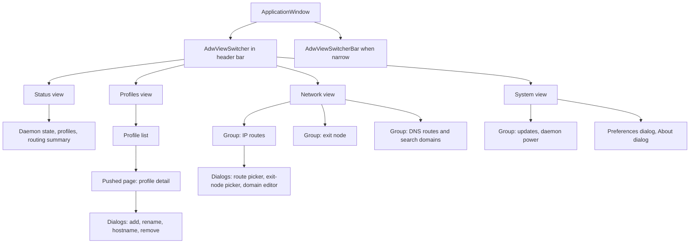

## Goal Capsule

- **Objective:** Give every tailmix capability a native GNOME desktop surface, in a Rust application that drives the existing `tailmix` CLI and adds no privileged surface of its own.
- **Means (fixed):** Rust, `gtk4` plus the `adw` crate, a self-contained crate under `gui/` that leaves for its own repository later, reads through `tailmix … --json`, mutations through `pkexec tailmix …`.
- **Product authority:** the CLI remains the reference implementation; where the GUI and the CLI disagree, the CLI behaviour wins.
- **Open blockers:** none, once the CLI `--json` additions ship as their own change.

---

## Product Contract

### Summary

A GTK4/libadwaita application, `tailmix-gui`, that shows and edits the whole of tailmix's state — profiles, IP routes, exit nodes, DNS routes and search domains, WireGuard and WARP profiles, daemon power, and updates — in one window with four views. It is a second client of the same daemon, and it never replaces or wraps the terminal workflow.

### Problem Frame

tailmix's capability lives behind subcommand flags: route policy is per-prefix `routes bind`, exit-node selection is one global choice among nodes filtered by country, DNS routing is a parallel policy tree, and raw WireGuard and WARP profiles are declarative manifests. Seeing what is currently true, and changing one thing without disturbing another, requires a terminal and command recall. The daemon already models every one of these as structured JSON; only the presentation is missing.

### Requirements

**Application shell**

- R1. Ships as a binary `tailmix-gui` built from a self-contained crate in `gui/`, with application id `io.github.nhubaotruong.TailmixGui`, a `.desktop` entry, and an app icon.
- R2. Presents one window with four top-level views — Status, Profiles, Network, System — selected by an `AdwViewSwitcher` in the header bar.
- R3. Moves the view switcher into an `AdwViewSwitcherBar` when the window is too narrow for the header position.
- R4. Opens a profile's detail by pushing a page inside the Profiles view, and never opens a third level of navigation.
- R5. Edits routes, exit nodes, DNS policy, and profile settings in dialogs or bottom sheets over the page that owns them.
- R6. Runs as a single instance, and presents the existing window when launched again.
- R7. Provides Preferences and About as an `AdwPreferencesDialog` and an `AdwAboutDialog`.
- R8. Closes the window with Ctrl+W and opens a keyboard-shortcut dialog from Ctrl+?.
- R9. Follows the system colour scheme, with a Preferences control offering follow-system, light, and dark.

**Reading state**

- R10. Reads all state by running `tailmix … --json` as the logged-in user, and never speaks the daemon socket protocol.
- R11. Never runs as root, and refuses to start when the effective user is root.
- R12. Refreshes on a timer, on manual refresh with Ctrl+R, and immediately after every successful change.
- R13. Shows a full-view empty state offering to start `tailmixd` through `pkexec` when the daemon is unreachable.
- R14. Reports a failed read in a banner and keeps the last known state on screen.
- R15. Shows a warning banner, not a hard failure, when the installed CLI cannot produce the JSON the GUI expects.

**Status view**

- R16. Shows whether the daemon is up or down, with the daemon version and the CLI version.
- R17. Summarises each profile as connected or offline with its peer count, MagicDNS name, and last connection time.
- R18. Summarises the accepted IP routes, the selected exit node, the installed DNS routes, and the search domains.

**Profiles**

- R19. Lists every profile with its runtime state, including removed profiles behind a filter.
- R20. Adds a Tailscale profile with a name, hostname, state directory, disabled flag, and an optional auth key supplied from a file the GUI creates and deletes.
- R21. Renames a profile and changes its hostname.
- R22. Enables, disables, and restarts a profile.
- R23. Removes a profile, offering a separate purge action that names what it deletes.
- R24. Shows a pending login's auth URL with actions to copy it and to open it in the browser.

**Network view: IP routes and exit node**

- R25. Lists IP route bindings with prefix, bound profile, policy, state, and the reason a route is or is not effective.
- R26. Binds one or more prefixes to a profile and unbinds them.
- R27. Toggles accept-all subnet routes per profile.
- R28. Offers advertised-but-unaccepted prefixes from `routes list --available` in a picker.
- R29. Lists available exit nodes, filtered by country, and sets the single selected exit node.
- R30. Clears the selected exit node and shows which profile currently owns it.

**Network view: DNS**

- R31. Lists DNS route bindings with domain, bound profile, source, state, and the reason a route is or is not effective.
- R32. Binds and unbinds domains, including the root suffix that selects a profile's default resolver.
- R33. Toggles accept-all DNS routes per profile.
- R34. Adds, removes, replaces, and clears search domains, showing which ones are desired but not yet installed.

**WireGuard and WARP**

- R35. Applies a raw WireGuard manifest from a picked file or pasted text, and shows validation errors without changing state.
- R36. Shows a WireGuard profile's public key, listen port, addresses, DNS suffix, grant count, and peers with online state, handshake age, and byte counts.
- R37. Toggles shields-up for a WireGuard profile.
- R38. Registers or imports a WARP profile from a team token or a `config.json`, with resolver and transport choice, after an in-app Terms of Service confirmation.

**System view**

- R39. Starts and stops every enabled profile through `tailmix up` and `tailmix down`.
- R40. Shows automatic-update state, and checks for and applies an update through `pkexec`.
- R41. Enables and disables automatic updates.

**Upstream passthrough**

- R42. Runs `tailmix ts --profile <name> <args>` for non-interactive subcommands and shows the captured output in a dialog.
- R43. Refuses subcommands that need a terminal or open a web page, showing the exact command with a copy action.

**Privilege, secrets, and errors**

- R44. Runs every mutating command through `pkexec tailmix …`, so authentication happens at the moment of the change.
- R45. Treats a dismissed or failed pkexec prompt as no change, reporting it in a toast and leaving state untouched.
- R46. Keeps auth keys, WARP team tokens, and WireGuard private keys out of process arguments and out of the GUI's logs.
- R47. Makes no network requests of its own; all traffic stays inside the daemon, reached through the CLI.
- R48. Requires `--json` on `tailmix warp`, `tailmix up`, `tailmix down`, `tailmix version`, `tailmix profiles rename`, and `tailmix profiles set` so no view parses human-readable output.

### Key Decisions

- **Rust with gtk4-rs and the `adw` crate.**
  Native Adwaita widgets, MIT licensing, and no cgo in the CLI tree.
  (session-settled: user-directed — chosen over Go with gotk4: gotk4-adwaita is AGPL-3.0 and forces cgo builds.)
  Governs R1.

- **The crate lives in `gui/` for now and moves to its own repository later.**
  The GUI stays separate code with its own toolchain, while the first iteration is easy to build and test beside the CLI.
  (session-settled: user-directed)
  Governs R1.

- **The CLI's `--json` output is the read contract.**
  One machine-readable surface, already exercised by tests, shared with the CLI.
  (session-settled: user-directed — chosen over an HTTP client on the daemon socket: keeps the GUI unprivileged and decoupled from `controlapi`.)
  Governs R10, R15, R48.

- **Every mutation is `pkexec tailmix …`.**
  polkit supplies authentication and auditing, and the daemon keeps rejecting non-root mutations unchanged.
  (session-settled: user-approved — chosen over a root helper process or running the GUI as root.)
  Governs R44, R45.

- **Flat view switcher, detail pushed inside Profiles.**
  HIG allows one level of depth beneath a flat top level, and four views fit a view switcher.
  (session-settled: user-approved — chosen over a navigation split view with a sidebar.)
  Governs R2, R3, R4, R5.

- **Linux with GNOME only.**
  libadwaita is a GNOME surface; macOS keeps the CLI.
  (session-settled: user-directed)
  Governs R1.

- **Unsandboxed binary, no Flatpak.**
  A sandbox blocks both `tailmix` and `pkexec`.
  (session-settled: user-directed — chosen over a Flatpak distribution.)
  Governs R1, R44.

- **Polling rather than streaming.**
  The daemon exposes no event or long-poll endpoint.
  Governs R12.

### Actors

- **Operator:** the desktop user running the GUI, unprivileged, authenticated on demand by polkit.
- **polkit agent:** prompts for and validates credentials for each `pkexec` invocation.
- **`tailmixd`:** owns all state and policy; the only component that touches the network stack.
- **`tailmix` CLI:** the contract between the GUI and the daemon.
- **`tailmix-gui`:** renders state and issues commands; holds no policy of its own.

### Key Flows

- F1. Bind a subnet prefix to a profile.
  - **Trigger:** the operator picks a prefix from the advertised list in the Network view.
  - **Steps:** GUI runs `pkexec tailmix routes bind --profile <name> <prefix> --json`; polkit prompts; the command returns the updated binding set; the GUI refreshes.
  - **Outcome:** the prefix appears as bound, with its effective state and reason.
  - **Covers R25, R26, R28, R44, R45.**

- F2. Add a Tailscale profile with an auth key.
  - **Trigger:** the operator fills the Add Profile dialog and pastes an auth key.
  - **Steps:** GUI writes the key to a mode-0600 temporary file, runs `pkexec tailmix profiles add <name> --auth-key-file <tmp> --json`, deletes the file, refreshes.
  - **Outcome:** the profile exists and shows a pending login with its auth URL.
  - **Covers R20, R24, R46.**

- F3. Select an exit node.
  - **Trigger:** the operator chooses a node in the exit-node picker.
  - **Steps:** GUI runs `pkexec tailmix exit-node set --profile <name> <peer> --json`; on success it refreshes and shows which profile now owns the default route.
  - **Outcome:** exactly one exit node is selected across all profiles, or none.
  - **Covers R29, R30.**

- F4. Start a stopped daemon.
  - **Trigger:** the Status view finds the daemon unreachable.
  - **Steps:** the empty state offers Start; the GUI runs `pkexec tailmix up` and then refreshes.
  - **Outcome:** profiles come back and the empty state is replaced by live state.
  - **Covers R13, R39.**

### Visualizations

### Acceptance Examples

- AE1. Route bind without a prompt after a recent prompt.
  - **Covers R26, R44.**
  - **Given:** the operator authenticated a change two minutes ago.
  - **When:** they bind `10.20.0.0/16` to `lab`.
  - **Then:** polkit returns cached authorisation, the binding appears, and no terminal is involved.

- AE2. Dismissed authorisation.
  - **Covers R45.**
  - **Given:** the exit-node picker is open.
  - **When:** the operator dismisses the polkit prompt.
  - **Then:** a toast says the change was cancelled, the previously selected node stays, and no partial state is written.

- AE3. Daemon not running.
  - **Covers R13, R14.**
  - **Given:** `tailmixd` is stopped.
  - **When:** the GUI starts.
  - **Then:** it shows the empty state with a Start action instead of an error dialog, and starting it needs one polkit prompt.

- AE4. Update check needs root.
  - **Covers R40.**
  - **Given:** the System view is open and automatic updates are enabled.
  - **When:** the operator presses Check Now.
  - **Then:** a polkit prompt appears, because checking is a mutating daemon call, and the result replaces the stale version text.

### Success Criteria

- Every capability listed in `tailmix help` is reachable in the GUI without typing a command.
- The GUI performs no state change that the CLI performs differently; each mutation maps to exactly one CLI invocation with `--json`.
- The CLI additions in R48 leave `make check` green in this repository.
- All four views are operable by keyboard alone, with visible focus and no colour-only status signal.

### Scope Boundaries

- A macOS GUI; macOS keeps the CLI.
- A Flatpak or sandboxed build, and anything requiring portals instead of direct `pkexec`.
- A tray icon, background residency, or desktop notifications.
- Live packet counters, streaming peer statistics, or a connection timeline.
- Replacing, wrapping, or deprecating the CLI, and any change to the daemon's authorisation model.
- Managing the systemd unit beyond starting and stopping profiles (no install or uninstall from the GUI).
- Translations beyond the English strings the GUI ships.
- Accessibility work beyond the semantics Adwaita provides by default.

### Dependencies and Assumptions

- `tailmix` and `tailmixd` are installed at `/usr/bin`, the daemon runs as a systemd service, and the control socket is at `/var/run/tailmix` or `$TAILMIX_SOCKET_DIR`.
- The R48 CLI additions land first, as their own CLI-only change and release, before the views that consume them. The GUI depends on that release, not on unreleased CLI behaviour.
- The crate in `gui/` must not import the Go module: its only contact with tailmix is the installed `tailmix` binary. Moving it to its own repository is a directory move, not a refactor.
- Building requires `gtk4-devel`, `libadwaita-devel`, and a Rust toolchain; the development host is Fedora Silverblue without GTK development headers, so builds happen in a distrobox container or after layering packages.
- A polkit agent is running in the operator's session, as GNOME provides by default.
- `pkexec` preserves stdin, so `--auth-key-file -` and `wireguard apply --file -` work through it.
- Application id is `io.github.nhubaotruong.TailmixGui`; the crate lives in `gui/`.

### Outstanding Questions

**Resolve Before Planning**

None.

**Deferred to Planning**

- Exact poll interval, and whether polling pauses while the window is hidden.
- Whether `scripts/install.sh` in this repository should install the GUI, or the GUI repository ships its own installer.
- How the GUI detects the CLI's JSON shape version, since the daemon exposes no schema version beyond `/v1/version`.

### Sources

- GNOME HIG: `https://developer.gnome.org/hig/guidelines.html`, `navigation.html`, `ui-styling.html`, `patterns/nav/view-switchers.html`, `patterns/nav/sidebars.html`, `patterns/containers/windows.html`.
- `libadwaita` 0.9.2 (MIT) and `gtk4` 0.11.4 crate documentation on docs.rs.
- Repository evidence: `cmd/tailmix/main.go` (dispatch and help text), `cmd/tailmixd/controlserver.go:82-98` (root-gated mutations), `profilesocket/path.go:19` (default socket directory), `controlapi/types.go:158-165` (`Status` shape), `scripts/install.sh:83-85` (installed binaries).
