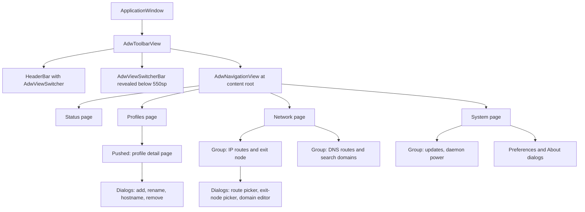
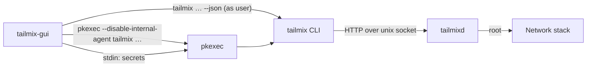
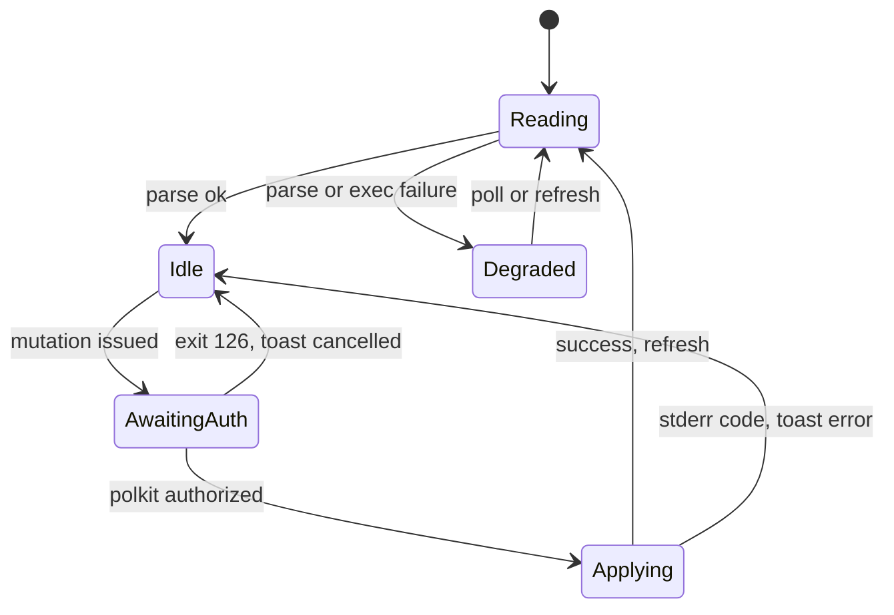

## Goal Capsule

- **Objective:** A GNOME operator can see and change every tailmix policy — profiles, IP routes, exit node, DNS routes and search domains, WireGuard and WARP profiles, daemon power, and updates — from one native window, without a terminal and without the CLI losing any capability.
- **Means (fixed):** Rust, `gtk4` plus the `adw` crate, a self-contained crate under `gui/` that leaves for its own repository later, reads through `tailmix … --json`, mutations through `pkexec tailmix …` (KTD1).
- **Product authority:** the CLI remains the reference implementation; where the GUI and the CLI disagree, the CLI behaviour wins.
- **Execution profile:** code, eight implementation units, one atomic commit per unit; U1 is a Go change in this repository, U2–U8 are the new crate.
- **Open blockers:** none, once the CLI `--json` additions ship as their own release (U1).

---

## Product Contract

### Summary

A GTK4/libadwaita application, `tailmix-gui`, that shows and edits the whole of tailmix's state — profiles, IP routes, exit nodes, DNS routes and search domains, WireGuard and WARP profiles, daemon power, and updates — in one window with four views.
It is a second client of the same daemon, and it never replaces or wraps the terminal workflow.

### Problem Frame

tailmix's capability lives behind subcommand flags: route policy is per-prefix `routes bind`, exit-node selection is one global choice among nodes filtered by country, DNS routing is a parallel policy tree, and raw WireGuard and WARP profiles are declarative manifests.
Seeing what is currently true, and changing one thing without disturbing another, requires a terminal and command recall.
The daemon already models every one of these as structured JSON; only the presentation is missing.

### Requirements

**Application shell**

- R1. Ships as a binary `tailmix-gui` built from a self-contained crate in `gui/`, with application id `io.github.nhubaotruong.TailmixGui`, a `.desktop` entry, and an app icon.
- R2. Presents one window with four top-level views — Status, Profiles, Network, System — selected by an `AdwViewSwitcher` in the header bar.
- R3. Moves the view switcher into an `AdwViewSwitcherBar` when the window is too narrow for the header position.
- R4. Opens a profile's detail by pushing a page inside the Profiles view, and never opens a third level of navigation.
- R5. Edits routes, exit nodes, DNS policy, and profile settings in dialogs or bottom sheets over the page that owns them.
- R6. Runs as a single instance, and presents the existing window when launched again.
- R7. Provides Preferences and About as an `AdwPreferencesDialog` and an `AdwAboutDialog`.
- R8. Closes the window with Ctrl+W and opens a keyboard-shortcut dialog from Ctrl+?.
- R9. Follows the system colour scheme, with a Preferences control offering follow-system, light, and dark.

**Reading state**

- R10. Reads all state by running `tailmix … --json` as the logged-in user, and never speaks the daemon socket protocol.
- R11. Never runs as root, and refuses to start when the effective user is root.
- R12. Refreshes on a timer, on manual refresh with Ctrl+R, and immediately after every successful change.
- R13. Shows a full-view empty state offering to start `tailmixd` through `pkexec` when the daemon is unreachable.
- R14. Reports a failed read in a banner and keeps the last known state on screen.
- R15. Shows a warning banner, not a hard failure, when the installed CLI cannot produce the JSON the GUI expects.

**Status view**

- R16. Shows whether the daemon is up or down, with the daemon version and the CLI version.
- R17. Summarises each profile as connected or offline with its peer count, MagicDNS name, and last connection time.
- R18. Summarises the accepted IP routes, the selected exit node, the installed DNS routes, and the search domains.

**Profiles**

- R19. Lists every profile with its runtime state, including removed profiles behind a filter.
- R20. Adds a Tailscale profile with a name, hostname, state directory, disabled flag, and an optional auth key.
- R21. Renames a profile and changes its hostname.
- R22. Enables, disables, and restarts a profile.
- R23. Removes a profile, offering a separate purge action that names what it deletes.
- R24. Shows a pending login's auth URL with actions to copy it and to open it in the browser.

**Network view: IP routes and exit node**

- R25. Lists IP route bindings with prefix, bound profile, policy, state, and the reason a route is or is not effective.
- R26. Binds one or more prefixes to a profile and unbinds them.
- R27. Toggles accept-all subnet routes per profile.
- R28. Offers advertised-but-unaccepted prefixes from `routes list --available` in a picker.
- R29. Lists available exit nodes, filtered by country, and sets the single selected exit node.
- R30. Clears the selected exit node and shows which profile currently owns it.

**Network view: DNS**

- R31. Lists DNS route bindings with domain, bound profile, source, state, and the reason a route is or is not effective.
- R32. Binds and unbinds domains, including the root suffix that selects a profile's default resolver.
- R33. Toggles accept-all DNS routes per profile.
- R34. Adds, removes, replaces, and clears search domains, showing which ones are desired but not yet installed.

**WireGuard and WARP**

- R35. Applies a raw WireGuard manifest from a picked file or pasted text, and shows validation errors without changing state.
- R36. Shows a WireGuard profile's public key, listen port, addresses, DNS suffix, grant count, and peers with online state, handshake age, and byte counts.
- R37. Toggles shields-up for a WireGuard profile.
- R38. Registers or imports a WARP profile from a team token or a `config.json`, with resolver and transport choice, after an in-app Terms of Service confirmation.

**System view**

- R39. Starts and stops every enabled profile through `tailmix up` and `tailmix down`.
- R40. Shows automatic-update state, and checks for and applies an update through `pkexec`.
- R41. Enables and disables automatic updates.

**Upstream passthrough**

- R42. Runs `tailmix ts --profile <name> <args>` for non-interactive subcommands and shows the captured output in a dialog.
- R43. Refuses subcommands that need a terminal or open a web page, showing the exact command with a copy action.

**Privilege, secrets, and errors**

- R44. Runs every mutating command through `pkexec tailmix …`, so authentication happens at the moment of the change.
- R45. Treats a dismissed or failed pkexec prompt as no change, reporting it in a toast and leaving state untouched.
- R46. Keeps auth keys, WARP team tokens, and WireGuard private keys out of process arguments, environment variables, files on disk, and the GUI's logs, and passes them to the CLI on standard input.
- R47. Makes no network requests of its own; all traffic stays inside the daemon, reached through the CLI.
- R48. Requires `--json` on `tailmix warp`, `tailmix up`, `tailmix down`, `tailmix version`, and `tailmix profiles rename`, and requires every `--json` command to report a failure as one JSON object on standard error carrying a stable `code`, so no view parses human-readable output.

### Key Decisions

- **Rust with gtk4-rs and the `adw` crate.**
  Native Adwaita widgets, MIT licensing, and no cgo in the CLI tree.
  (session-settled: user-directed — chosen over Go with gotk4: gotk4-adwaita is AGPL-3.0 and forces cgo builds.)
  Governs R1.

- **The crate lives in `gui/` for now and moves to its own repository later.**
  The GUI stays separate code with its own toolchain, while the first iteration is easy to build and test beside the CLI.
  (session-settled: user-directed)
  Governs R1.

- **The CLI's `--json` output is the read contract.**
  One machine-readable surface, already exercised by tests, shared with the CLI.
  (session-settled: user-directed — chosen over an HTTP client on the daemon socket: keeps the GUI unprivileged and decoupled from `controlapi`.)
  Governs R10, R15, R48.

- **Every mutation is `pkexec tailmix …`.**
  polkit supplies authentication and auditing, and the daemon keeps rejecting non-root mutations unchanged.
  (session-settled: user-approved — chosen over a root helper process or running the GUI as root.)
  Governs R44, R45.

- **Flat view switcher, detail pushed inside Profiles.**
  HIG allows one level of depth beneath a flat top level, and four views fit a view switcher.
  (session-settled: user-approved — chosen over a navigation split view with a sidebar.)
  Governs R2, R3, R4, R5.

- **Linux with GNOME only.**
  libadwaita is a GNOME surface; macOS keeps the CLI.
  (session-settled: user-directed)
  Governs R1.

- **Unsandboxed binary, no Flatpak.**
  A sandbox blocks both `tailmix` and `pkexec`.
  (session-settled: user-directed — chosen over a Flatpak distribution.)
  Governs R1, R44.

- **Polling rather than streaming.**
  The daemon exposes no event or long-poll endpoint.
  Governs R12.

- **No custom polkit action in the first release.**
  Generic `org.freedesktop.policykit.exec` is `auth_admin` without `_keep`, so each change prompts once (KTD8); a dedicated action file that restores cached authorization is deferred until prompting proves to be a burden.
  Governs R44, R45.

### Actors

- **Operator:** the desktop user running the GUI, unprivileged, authenticated on demand by polkit.
- **polkit agent:** prompts for and validates credentials for each `pkexec` invocation.
- **`tailmixd`:** owns all state and policy; the only component that touches the network stack.
- **`tailmix` CLI:** the contract between the GUI and the daemon.
- **`tailmix-gui`:** renders state and issues commands; holds no policy of its own.

### Key Flows

- F1. Bind a subnet prefix to a profile.
  - **Trigger:** the operator picks a prefix from the advertised list in the Network view.
  - **Steps:** GUI runs `pkexec tailmix routes bind --profile <name> <prefix> --json`; polkit prompts; the command returns the updated binding set; the GUI refreshes.
  - **Outcome:** the prefix appears as bound, with its effective state and reason.
  - **Covers R25, R26, R28, R44, R45.**

- F2. Add a Tailscale profile with an auth key.
  - **Trigger:** the operator fills the Add Profile dialog and pastes an auth key.
  - **Steps:** GUI pipes the key to `pkexec tailmix profiles add <name> --auth-key-file - --json` on standard input and closes the pipe; the command returns; the GUI refreshes.
  - **Outcome:** the profile exists and shows a pending login with its auth URL.
  - **Covers R20, R24, R46.**

- F3. Select an exit node.
  - **Trigger:** the operator chooses a node in the exit-node picker.
  - **Steps:** GUI runs `pkexec tailmix exit-node set --profile <name> <peer> --json`; on success it refreshes and shows which profile now owns the default route.
  - **Outcome:** exactly one exit node is selected across all profiles, or none.
  - **Covers R29, R30.**

- F4. Start a stopped daemon.
  - **Trigger:** the Status view finds the daemon unreachable.
  - **Steps:** the empty state offers Start; the GUI runs `pkexec systemctl start tailmixd` and then refreshes, because `tailmix up` is itself a control-socket call and cannot work while the socket is dead (KTD5).
  - **Outcome:** profiles come back and the empty state is replaced by live state.
  - **Covers R13, R39.**

- F5. Apply an update.
  - **Trigger:** the System view reports an available version and the operator presses Apply.
  - **Steps:** GUI runs `pkexec tailmix update apply --json`; the daemon restarts profiles as it reports; the GUI polls until `state` settles.
  - **Outcome:** the version line shows the new version, or the last error in a banner.
  - **Covers R40, R41.**

### Visualizations



### Acceptance Examples

- AE1. Route bind after a recent prompt.
  - **Covers R26, R44.**
  - **Given:** the operator authenticated a change two minutes ago.
  - **When:** they bind `10.20.0.0/16` to `lab`.
  - **Then:** polkit prompts again, because the generic exec action is not kept; the operator authenticates in the polkit dialogue without a terminal, and the binding appears.

- AE2. Dismissed authorisation.
  - **Covers R45.**
  - **Given:** the exit-node picker is open.
  - **When:** the operator dismisses the polkit prompt.
  - **Then:** a toast says the change was cancelled, the previously selected node stays, and no partial state is written.

- AE3. Daemon not running.
  - **Covers R13, R14.**
  - **Given:** `tailmixd` is stopped.
  - **When:** the GUI starts.
  - **Then:** it shows the empty state with a Start action instead of an error dialog, and starting it needs one polkit prompt.

- AE4. Update check needs root.
  - **Covers R40.**
  - **Given:** the System view is open and automatic updates are enabled.
  - **When:** the operator presses Check Now.
  - **Then:** a polkit prompt appears, because checking is a mutating daemon call, and the result replaces the stale version text.

### Success Criteria

- Every capability listed in `tailmix help` is reachable in the GUI without typing a command.
- The GUI performs no state change that the CLI performs differently; each mutation maps to exactly one CLI invocation with `--json`.
- The CLI additions in R48 leave `make check` green in this repository.
- All four views are operable by keyboard alone, with visible focus and no colour-only status signal.

### Scope Boundaries

- A macOS GUI; macOS keeps the CLI.
- A Flatpak or sandboxed build, and anything requiring portals instead of direct `pkexec`.
- A tray icon, background residency, or desktop notifications.
- Live packet counters, streaming peer statistics, or a connection timeline.
- Replacing, wrapping, or deprecating the CLI, and any change to the daemon's authorisation model.
- Managing the systemd unit beyond starting the daemon and starting or stopping profiles (no install or uninstall from the GUI).
- A custom polkit action file in the first release (KTD8).
- Client-side caching of daemon state between runs, or any GUI-owned policy store beyond the colour-scheme preference.
- Translations beyond the English strings the GUI ships.
- Accessibility work beyond the semantics Adwaita provides by default.

### Dependencies and Assumptions

- `scripts/install.sh:102-103` installs `tailmix` and `tailmixd` into `/usr/local/bin`, not `/usr/bin`; the GUI resolves the binary through its own `PATH` at startup and passes the absolute path to `pkexec`, because `pkexec` resets `PATH` (KTD5).
- The daemon runs as a systemd service and the control socket is at `/var/run/tailmix` or `$TAILMIX_SOCKET_DIR`.
- The R48 CLI additions land first, as their own CLI-only change and release, before the views that consume them. The GUI depends on that release, not on unreleased CLI behaviour.
- The crate in `gui/` must not import the Go module: its only contact with tailmix is the installed `tailmix` binary. Moving it to its own repository is a directory move, not a refactor.
- Building requires `gtk4-devel`, `libadwaita-devel`, and a Rust toolchain of at least 1.83; the development host is Fedora Silverblue without GTK development headers, so builds happen in a distrobox container or after layering packages.
- A polkit agent is running in the operator's session, as GNOME provides by default.
- `pkexec` passes file descriptors 0–2 through unchanged, so stdin secrets and `--file -` work through it (KTD5).
- Application id is `io.github.nhubaotruong.TailmixGui`; the crate lives in `gui/`.

### Outstanding Questions

**Resolve Before Planning**

None.

**Deferred to Planning**

- Whether `scripts/install.sh` in this repository should install the GUI, or the GUI repository ships its own installer.
- Whether a dedicated polkit action file should replace the generic exec action, restoring cached authorization.

### Sources

- GNOME HIG: `https://developer.gnome.org/hig/guidelines.html`, `navigation.html`, `ui-styling.html`, `patterns/nav/view-switchers.html`, `patterns/nav/sidebars.html`, `patterns/containers/windows.html`.
- `libadwaita` 0.9.2 (MIT) and `gtk4` 0.11.4 crate documentation on docs.rs.
- Repository evidence: `cmd/tailmix/main.go` (dispatch and help text), `cmd/tailmix/main.go:790-811` (`profiles set --json` already exists), `cmd/tailmixd/controlserver.go:82-98` (root-gated mutations), `profilesocket/path.go:19` (default socket directory), `controlapi/types.go:158-165` (`Status` shape), `scripts/install.sh:102-103` (installed binaries).

---

## Planning Contract

### Key Technical Decisions

- KTD1. The GUI talks to tailmix only through the installed `tailmix` binary: reads run `tailmix <cmd> --json` as the user, mutations run `pkexec <absolute tailmix> <cmd> …`. It does not link the Go module, implement the socket protocol, or call HTTP directly.
  Governs R10, R44.

- KTD2. `libadwaita` is declared with `features = ["v1_6"]` and `gtk4` with `features = ["v4_10"]`, because `adw::Dialog`, `AdwAlertDialog`, `AdwPreferencesDialog`, `AdwBreakpoint`, `AdwNavigationView`, and `adw::StyleManager::set_color_scheme` are version-gated and the `libadwaita` crate has no default features. This sets the build floor to libadwaita 1.6 and GTK 4.10; the target host ships libadwaita 1.9 and GTK 4.24.
  Governs R2, R4, R7, R9.

- KTD3. The window is `AdwToolbarView` → `AdwNavigationView` at content root, one `AdwNavigationPage` per top-level view, each page carrying its own `AdwToolbarView` + `AdwHeaderBar` with an `AdwViewSwitcher`. A header bar owned by the window's toolbar view never shows a back button, so the pages must own theirs.
  Governs R2, R4, R5.

- KTD4. Narrow layout uses one `AdwBreakpoint` at `max-width: 550sp` whose setters reveal an `AdwViewSwitcherBar` and clear the header bar's title widget. `AdwViewSwitcherBar` has no automatic reveal in this binding, and the widget that used to do it (`AdwViewSwitcherTitle`) is deprecated; `AdwViewSwitcher::policy` still selects icon-only versus labelled rendering inside the header.
  Governs R3.

- KTD5. The privilege runner invokes `pkexec --disable-internal-agent <absolute tailmix path> …` with the resolved binary path, because `pkexec` resets `PATH` and its internal text agent needs `/dev/tty`, which a GTK process does not have. Exit code 126 means dismissed or failed authorization, 127 means no agent or the binary is gone, and any other non-zero code is a CLI failure carrying a stderr message; the GUI maps those to distinct user-visible outcomes.
  Governs R13, R43, R44, R45.

- KTD6. Secrets travel on standard input: the child's stdin is written and closed before the exit status is awaited, and `TAILMIX_SOCKET_DIR` is never relied on for mutations, because `pkexec` clears the environment.
  Governs R46.

- KTD7. Reads run through `gio::Subprocess` and `glib::spawn_future_local`, never a blocking `Command::output()` on the main loop; `glib::MainContext::channel` is gone in glib 0.22.
  Governs R12, R14.

- KTD8. Every mutation prompts: polkit's generic exec action is `auth_admin` without `_keep`, so there is no cached authorization to rely on. The GUI suppresses its own overlapping prompts with a single in-flight mutation, but it does not pretend a prompt was avoided.
  Governs R44, R45.

- KTD9. The poll runs every 2 s while the window is mapped, stops when it is hidden or unmapped, is single-flight, and is suspended while a mutation is in flight plus one settle refresh afterwards, so a poll can never revert a change that just succeeded.
  Governs R12, R14.

- KTD10. Failure reporting uses two surfaces: a toast for the result of one mutation, and a persistent banner for a degraded read path. Poll ticks that succeed show nothing.
  Governs R14, R15, R45.

- KTD11. R48 failures become one JSON object on standard error with `code` and `message`, mirroring `controlapi.Error`. Without it the GUI cannot tell "daemon down" from "not authorized" from "bad flag", because every CLI failure is currently exit 1 plus prose.
  Governs R13, R14, R15, R45, R48.

- KTD12. The colour-scheme preference is the only persisted GUI state, held in a `GSettings` schema whose XML lives in `gui/data/`, compiled by `build.rs` (the `glib-build-tools` crate exposes only `compile_resources`) and bundled into the binary's GResource, which is registered at startup, so the preference survives a restart without a system-wide schema install.
  Governs R9.

### High-Level Technical Design



Mutation lifecycle, which the UI renders as disabled controls plus a spinner:



### Assumptions

- The `--json` shapes of `status`, `profiles`, `routes`, `exit-node`, `dns`, `wireguard`, and `update` stay stable across the first release; there is no schema version, so the GUI validates required fields and degrades to R15's warning instead of failing.
- `tailmix up` requires a live daemon socket, so starting a stopped daemon is a `systemctl` action, not a CLI action (F4).
- A single mutation is in flight at a time; the operator does not need to queue two changes.
- No CI job builds the Rust crate in this release, because `.github/workflows/checks.yml` triggers only on Go and documentation paths, and a GTK build job would need system packages; local commands in the Verification Contract are the gate.

### Constraints

- No change to `controlapi`, the daemon's routes, or its root gating.
- No new privileged surface: no setuid helper, no polkit action file, no root-owned socket, no daemon environment variable.
- `gui/` must not alter `make check`, `go build ./...`, goreleaser, or the licenses scripts; it adds files that Go tooling does not walk.
- Strings are English, no translatable-markup work beyond what Adwaita defaults give.
- No network access outside the CLI subprocess.

### Sequencing

U1 ships alone and lands first, because U3–U8 depend on its JSON shapes.
U2 establishes the shell and packaging that every later unit mounts into.
U3 delivers the bridge and the Status view, which is the first end-to-end proof.
U4–U8 are independent of each other and can land in any order after U3.

### Product Contract preservation

Five sentences were corrected for mechanism accuracy and one was extended: R20 no longer names a GUI-written key file, R46 now owns the stdin rule, R48 names five commands instead of six because `profiles set` already emits JSON (`cmd/tailmix/main.go:790-811`) and gains the error envelope that R13, R14, R15, and R45 already require, F2 pipes the key on stdin, F4 starts the daemon through `systemctl`, and AE1 no longer claims cached authorization.
Every R, F, and AE identifier is unchanged, no requirement was added or removed, and no product scope moved.

---

## Output Structure

```text
gui/
├── Cargo.toml
├── build.rs
├── README.md
├── data/
│   ├── io.github.nhubaotruong.TailmixGui.desktop
│   ├── io.github.nhubaotruong.TailmixGui.metainfo.xml
│   ├── io.github.nhubaotruong.TailmixGui.gschema.xml
│   └── icons/hicolor/scalable/apps/io.github.nhubaotruong.TailmixGui.svg
├── src/
│   ├── main.rs
│   ├── app.rs
│   ├── cli.rs
│   ├── model.rs
│   ├── poller.rs
│   ├── privilege.rs
│   ├── commands.rs
│   ├── views/
│   │   ├── mod.rs
│   │   ├── status.rs
│   │   ├── profiles.rs
│   │   ├── network_routes.rs
│   │   ├── network_dns.rs
│   │   ├── wireguard.rs
│   │   ├── warp.rs
│   │   └── system.rs
│   └── dialogs/
│       ├── mod.rs
│       ├── preferences.rs
│       ├── about.rs
│       └── ts_passthrough.rs
└── tests/
    ├── fixtures/*.json
    ├── parse.rs
    └── commands.rs
```

---

## Implementation Units

### U1. CLI JSON additions and JSON errors

- **Goal:** Every command the GUI runs can produce machine-readable output and a machine-readable failure, so no view parses prose.
- **Requirements:** R15, R45, R48.
- **Dependencies:** none.
- **Files:** `cmd/tailmix/main.go`, `cmd/tailmix/main_test.go`, `cmd/tailmix/warp_test.go`.
- **Approach:** Add `--json` to `warp`, `up`, `down`, `version`, and `profiles rename` using the existing `takeBool(&rest, "--json")` pattern, so the flag is accepted anywhere in the subcommand arguments; `profiles rename` currently rejects any fourth token (`cmd/tailmix/main.go:620-623`), so that operand check must accept the flag instead of rejecting it. The error envelope lives at each subcommand's own error return, not in `runWithDependencies`, because every subcommand consumes `--json` before returning (`cmd/tailmix/main.go:95-155` never sees the flag); one helper takes the parsed flag, the error, and the writers, emitting `{"code":…,"message":…}` on stderr when the flag is set and the current prose line otherwise, with exit codes 1 and 2 unchanged. Use a closed code vocabulary so the GUI can branch: `daemon_unavailable` for a failed socket dial, `permission_denied` for a rejected mutation, `invalid_argument` for a usage error, `not_found`, `already_exists`, `consent_required`, and `internal` otherwise. For `version --json` add a composite struct carrying the client version and an optional server version, because that command currently prints text and exits 0 when the daemon is down. `warp register` gains `--accept-tos`: with `--json` and without the flag it fails with `consent_required` and writes nothing, while the interactive prompt stays for human use.
- **Patterns to follow:** `runStatus` (`cmd/tailmix/main.go:561-583`) for the flag-then-`writeJSON` shape; `cmd/tailmix/main.go:790-811` for a command that already emits JSON; `controlapi.Error` for the error object's fields.
- **Test scenarios:**
  - `--json` after the positional arguments and before them both produce JSON, for each of the five commands.
  - `--json=true` and a repeated `--json` stay usage errors, matching current `takeBool` behaviour.
  - Each command's failure path with `--json` writes one JSON object to stderr with a non-empty `code`, and stdout stays empty.
  - The same failure without `--json` still writes the current prose line.
  - `version --json` reports the client version with the daemon down, and both versions with it up.
  - `profiles rename --json` reports the renamed profile object.
  - `up`/`down --json` report the daemon state object.
  - `warp register --json` fails with a code and a message when consent was not given, and writes nothing to the daemon.
- **Verification:** `go test ./cmd/tailmix` and `make check`.

### U2. Crate skeleton, window shell, and packaging

- **Goal:** A launchable single-instance window with four empty views, the narrow-layout switcher, Preferences and About, shortcuts, and installable desktop files.
- **Requirements:** R1, R2, R3, R6, R7, R8, R9.
- **Dependencies:** none, but lands after U1 to keep the CLI change atomic.
- **Files:** `gui/Cargo.toml`, `gui/build.rs`, `gui/README.md`, `gui/.gitignore`, `gui/data/io.github.nhubaotruong.TailmixGui.desktop`, `gui/data/io.github.nhubaotruong.TailmixGui.metainfo.xml`, `gui/data/io.github.nhubaotruong.TailmixGui.gschema.xml`, `gui/data/icons/hicolor/scalable/apps/io.github.nhubaotruong.TailmixGui.svg`, `gui/src/main.rs`, `gui/src/app.rs`, `gui/src/views/mod.rs`, `gui/src/dialogs/mod.rs`, `gui/src/dialogs/preferences.rs`, `gui/src/dialogs/about.rs`.
- **Approach:** `adw::Application` with the fixed application id and a `connect_activate` that builds one `AdwApplicationWindow`, so GApplication supplies single-instance behaviour. KTD3's structure gives each view its own toolbar and header; KTD4's breakpoint reveals the switcher bar; KTD12 holds the colour scheme; About and Preferences are dialogs, not windows. Preferences holds the colour-scheme choice and About renders the version and license. Add a `Settings`-backed colour-scheme action and a shortcuts dialog listing Ctrl+W, Ctrl+R, and Ctrl+?.
- **Patterns to follow:** the crate's own documented example (`adw::Application` → `ApplicationWindow` → `ToolbarView`); HIG windows guidance for the dialog-versus-window choice.
- **Test scenarios:**
  - Launching twice presents the existing window instead of starting a second process.
  - Resizing below 550sp reveals the switcher bar and hides the header switcher; resizing back reverses it.
  - Ctrl+W closes the window, Ctrl+R emits a refresh request, Ctrl+? opens the shortcuts dialog.
  - Switching each of the four views shows its page title and keeps its scroll position when returning.
  - The colour-scheme preference survives a restart and overrides the system scheme.
  - Preferences and About open as dialogs, close with Escape, and never stack over each other.
  - The `.desktop` entry, AppStream id, and icon name all equal the application id.
- **Verification:** `cd gui && cargo fmt --check`, `cargo clippy --all-targets --all-features -- -D warnings`, `cargo build`.

### U3. CLI bridge, polling, privilege runner, and Status view

- **Goal:** One code path reads state, one code path mutates it, and the Status view proves both end to end.
- **Requirements:** R5, R10, R11, R12, R13, R14, R15, R16, R17, R18, R44, R45, R46, R47.
- **Dependencies:** U1, U2.
- **Files:** `gui/src/cli.rs`, `gui/src/model.rs`, `gui/src/poller.rs`, `gui/src/privilege.rs`, `gui/src/commands.rs`, `gui/src/views/status.rs`, `gui/tests/parse.rs`, `gui/tests/commands.rs`, `gui/tests/fixtures/status.json`, `gui/tests/fixtures/status-daemon-down.json`.
- **Approach:** Locate `tailmix` with `glib::find_program_in_path` at startup and cache the absolute path; refuse to start as root by checking the effective uid. `model.rs` holds serde types mirroring `controlapi` (`Status`, `Profile`, `IPRoutes`, `ExitNodes`, `DNSRoutes`, `SearchDomains`) and tolerates absent fields, mapping an unparsable payload to R15's warning rather than an error. `cli.rs` builds an argument vector from a typed command enum and runs it through `gio::Subprocess`, so no view constructs argv strings; the same enum renders the copyable command text for R43. `privilege.rs` prefixes `pkexec --disable-internal-agent <path>` and maps 126 and 127 per KTD5; `commands.rs` writes stdin secrets per KTD6 and enforces one in-flight mutation. `poller.rs` implements KTD9 and KTD10's toast-versus-banner split. The Status view renders the four summary groups and R13's empty state.
- **Technical design:** state lives in one `Rc<RefCell<AppState>>`; every asynchronous completion re-enters the main loop through `glib::spawn_future_local` and then re-renders from a single `render(&AppState)` function, so widget updates never race each other.
- **Patterns to follow:** `controlapi/types.go` for field names and nullability; `cmd/tailmix/main.go` for the exact per-command argument order; `profilesocket/path.go:19` for the socket location the CLI already resolves.
- **Test scenarios:**
  - Parsing each fixture produces the expected profile count, daemon state, and route summary; a fixture with a renamed field surfaces R15's warning instead of a panic.
  - Daemon-down output produces the empty state, not a banner plus stale numbers.
  - A child that exits 1 with a JSON error produces a toast carrying that `code`, and R14's banner stays clear.
  - Exit 126 produces "cancelled" and leaves the previous state untouched; exit 127 produces an actionable "polkit agent unavailable" message that names `pkexec --disable-internal-agent`.
  - Running as root refuses to start with a single explanatory line on stderr.
  - A mutation in flight blocks a second one and pauses the poll; when it finishes, exactly one settle refresh follows.
  - The poll stops while the window is hidden and resumes on map.
  - A secret reaches the child on stdin and never appears in the rendered command text.
- **Verification:** `cd gui && cargo test`; manual check against a live and a stopped daemon.

### U4. Profiles view

- **Goal:** Every profile operation the CLI exposes is available from a list and its detail page.
- **Requirements:** R4, R19, R20, R21, R22, R23, R24.
- **Dependencies:** U3.
- **Files:** `gui/src/views/profiles.rs`, `gui/tests/commands.rs`, `gui/tests/fixtures/profiles.json`.
- **Approach:** A `gio::ListStore` of profile records behind a `FilterListModel` that hides removed profiles unless the filter is on. The detail page is a pushed `AdwNavigationPage` with `AdwActionRow` groups and a menu for rename, hostname, enable/disable, restart, remove, and purge. Add Profile is a `AdwDialog` with entry rows plus an auth-key entry that is written to stdin only. A pending login renders R24's URL with copy and open actions, and the open action goes through `gtk::UriLauncher`, not through the GUI's own network stack.
- **Patterns to follow:** `tailmix profiles` help text for argument names; `docs/profile-management.md` for what purge deletes, so the confirmation names the real paths.
- **Test scenarios:**
  - The removed-profile filter hides and reveals removed rows without refetching.
  - Add with an auth key pipes the key on stdin and omits the flag entirely when the field is empty.
  - Rename and hostname changes issue exactly one command each and refresh once.
  - Enable, disable, and restart render the resulting runtime state after the refresh.
  - Remove asks for confirmation; purge asks again and names the state directory.
  - The auth URL copies to the clipboard and opens in the browser without the GUI fetching anything.
- **Verification:** `cd gui && cargo test`, plus a manual pass against a live daemon.

### U5. Network view: IP routes and exit node

- **Goal:** Route policy and exit-node choice become visible and editable, with the reason an entry is ineffective shown next to it.
- **Requirements:** R25, R26, R27, R28, R29, R30.
- **Dependencies:** U3.
- **Files:** `gui/src/views/network_routes.rs`, `gui/tests/commands.rs`, `gui/tests/fixtures/routes.json`, `gui/tests/fixtures/exit-nodes.json`.
- **Approach:** Two `AdwPreferencesGroup`s: bindings with prefix, profile, policy, state, and reason, plus accept-all rows per profile; and one exit-node row showing the owner and a picker dialog with a country filter fed from `exit-node list --filter`. The route picker lists `routes list --available` entries with multi-select for R26. Bind, unbind, set, clear, and accept-all all go through the typed command enum.
- **Patterns to follow:** `controlapi.IPRouteBinding` and `controlapi.SelectedExitNode` for the fields worth showing; `tailmix routes list` and `tailmix exit-node list` help text for flags.
- **Test scenarios:**
  - A binding whose `state` is overridden shows `overriddenBy` and the overriding profile.
  - Multi-select binds several prefixes in one command and refreshes once.
  - Accept-all toggles issue one `routes set --accept-all=<true|false>` per profile and reflect the result; the spaced form `--accept-all true` is a usage error and is never emitted.
  - The country filter narrows the picker and clearing it restores the full list.
  - Selecting an exit node replaces the previous owner in the same refresh; clearing removes the row and shows "None".
  - An empty available-routes list renders an explanatory empty state instead of an empty dialog.
- **Verification:** `cd gui && cargo test`, plus a manual pass with two profiles.

### U6. Network view: DNS routes and search domains

- **Goal:** The DNS policy tree and search-domain list are editable without command recall.
- **Requirements:** R31, R32, R33, R34.
- **Dependencies:** U3.
- **Files:** `gui/src/views/network_dns.rs`, `gui/tests/commands.rs`, `gui/tests/fixtures/dns.json`.
- **Approach:** A bindings group with domain, profile, source, state, and reason; a domain editor that accepts a suffix and explains the root-suffix case; accept-all rows; and a search-domain group that shows desired, installed, and waiting entries separately so R34's "not yet installed" state is visible. Search-domain edits use `dns search add`, `dns search remove`, `dns search set` for a whole-list replacement, and `dns search clear`, rather than a read-modify-write loop.
- **Patterns to follow:** `controlapi.DNSRouteBinding` and `controlapi.SearchDomains` for fields; the mirror structure of `routes` for command naming.
- **Test scenarios:**
  - A waiting search domain is visibly distinct from an installed one and is not reported as an error.
  - Adding a domain issues one bind command and refreshes once.
  - Binding the root suffix is offered explicitly and labelled with what it does.
  - Removing one search domain uses `dns search remove` and leaves the others untouched.
  - Clear empties the list after one confirmation.
  - A reconcile error renders as a banner naming `reconcileError`.
- **Verification:** `cd gui && cargo test`, plus a manual pass.

### U7. WireGuard and WARP

- **Goal:** Raw WireGuard manifests and WARP profiles can be authored, applied, and inspected from the GUI.
- **Requirements:** R35, R36, R37, R38.
- **Dependencies:** U3.
- **Files:** `gui/src/views/wireguard.rs`, `gui/src/views/warp.rs`, `gui/tests/commands.rs`, `gui/tests/fixtures/wireguard.json`.
- **Approach:** WireGuard apply is a dialog with a file picker (`gtk::FileDialog`) or a text view, and its content goes to stdin as `--file -` so the manifest is never an argument; validation failures render the CLI's message and leave the view unchanged. The profile view shows the key, port, addresses, DNS suffix, grant count, and a peer list with online state, handshake age, and byte counts. WARP register is a dialog with team-token or `config.json` input, resolver and transport choices, and an in-app Terms of Service checkbox that gates submission.
- **Patterns to follow:** `docs/wireguard.md` and `docs/warp.md` for the manifest and registration shapes; `tailmix wireguard` and `tailmix warp` help text for flags.
- **Test scenarios:**
  - A pasted manifest reaches the child on stdin and never appears in the command text.
  - An invalid manifest leaves the previous profile list unchanged and shows the CLI's validation message.
  - Byte counts render as human units and stay stable across two polls with the same values.
  - The ToS checkbox must be checked before Register is enabled.
  - A WARP registration failure reports the code from U1 rather than a generic failure.
  - Shields-up toggles issue one command and reflect the returned state.
- **Verification:** `cd gui && cargo test`, plus a manual pass with a test manifest.

### U8. System view and passthrough

- **Goal:** Daemon power, updates, and the `tailmix ts` escape hatch complete the surface.
- **Requirements:** R39, R40, R41, R42, R43.
- **Dependencies:** U3.
- **Files:** `gui/src/views/system.rs`, `gui/src/dialogs/ts_passthrough.rs`, `gui/tests/commands.rs`, `gui/tests/fixtures/update.json`.
- **Approach:** System view groups daemon power (`up`, `down`) and update state (enabled, current, available, last checked, last error) with Check Now and Apply actions, each through the privilege runner. Automatic-update enabling and disabling is a switch that issues one command. The passthrough dialog takes a profile, a subcommand, and free-text arguments, refuses the enumerated interactive and browser-opening subcommands with R43's copyable command, and otherwise renders captured stdout and stderr with exit status.
- **Patterns to follow:** `tailmix update status` and `tailmix ts` help text; `controlapi.UpdateStatus` for the fields to display.
- **Test scenarios:**
  - Up and Down issue one command each and disable the other action while in flight.
  - Check Now with updates disabled explains why it is unavailable instead of prompting.
  - A failed apply shows `lastError` in a banner and keeps the previous version text.
  - Parsing `gui/tests/fixtures/update.json` fills every update field, and an absent `availableVersion` renders as "up to date".
  - Passthrough refuses `login`, `up`, and `status --web --browser`, showing the full command with a copy action.
  - A non-interactive passthrough renders stdout, stderr, and a non-zero exit status without a modal.
- **Verification:** `cd gui && cargo test`, plus a manual pass.

---

## Verification Contract

Repository commands, run from the stated directory:

- `make check` — after U1 and before any commit that touches Go code; covers `go test ./...`, `go vet ./...`, staticcheck, govulncheck, `go mod tidy -diff`, license checks, and the install test.
- `cd gui && cargo fmt --check`
- `cd gui && cargo clippy --all-targets --all-features -- -D warnings`
- `cd gui && cargo test`
- `cd gui && cargo build --release` — requires `pkg-config --modversion gtk4` at 4.10 or newer and `libadwaita-1` at 1.6 or newer on the build host.

Measurable thresholds:

- No view parses human-readable CLI output: every state read is a `--json` invocation, enforced by `gui/tests/parse.rs` covering every fixture.
- No mutation runs without `pkexec`, and no secret appears in a rendered command: enforced by `gui/tests/commands.rs`.
- A poll never overlaps a mutation: the state machine test drives issue, authorize, and settle transitions and asserts a single in-flight operation.

Manual smoke pass, run under a GNOME session with `tailmixd` running, then stopped:

- Four views switch, a profile detail pushes and pops, and no third level exists.
- Daemon stopped shows the empty state, and Start brings it back with one polkit prompt.
- One mutation per view succeeds after a prompt, and dismissing a prompt leaves state untouched.
- The window narrows to the switcher bar and restores.

## Definition of Done

- Every requirement R1–R48 is reachable in the built application.
- `make check` passes in the repository root, and the four `gui/` commands pass.
- `gui/` contains no reference to the Go module, and the Go tooling never walks it.
- The desktop entry, AppStream metadata, and icon are installed by the command documented in `gui/README.md`, and the application launches from the desktop.
- The manual smoke pass is executed once against a live daemon and once against a stopped one.
- Per unit: the unit's own tests exist and pass, and its commit is atomic.
- Cleanup: no abandoned alternate approach, no dead command variant, and no commented-out widget tree remains in `gui/`.

---

## Appendix

Deferred to follow-up work:

- A CI job that builds and tests `gui/`, needing a Rust toolchain and GTK development packages in `.github/workflows/checks.yml`.
- A dedicated polkit action file restoring cached authorization, if per-change prompts prove burdensome.
- Installer ownership for the GUI binary (Outstanding Questions).
- A JSON schema version negotiated with the CLI, replacing R15's field validation.
